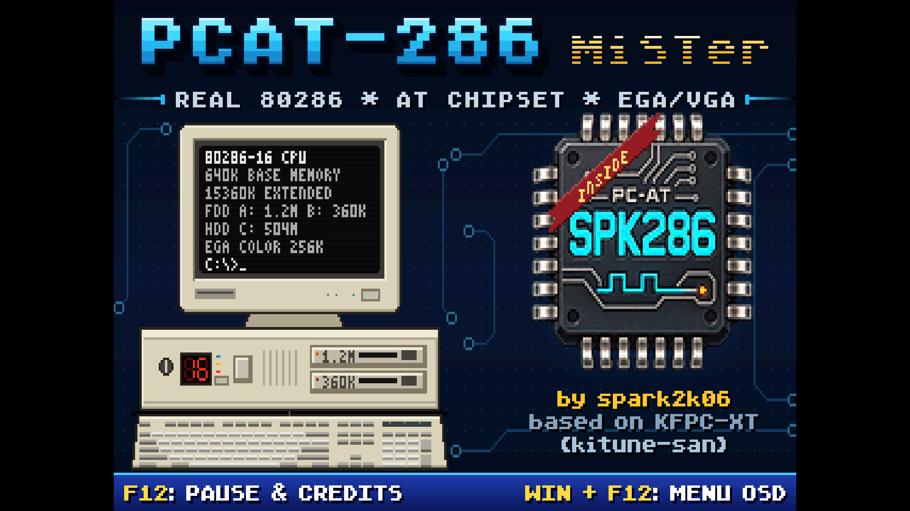
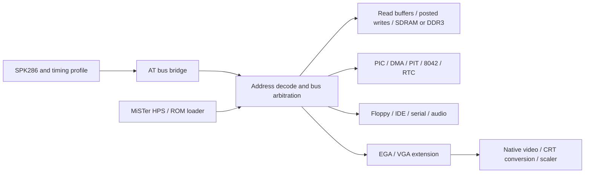

# PCAT-286 for MiSTer FPGA



PCAT-286 is an Intel 80286-compatible PC/AT implementation for MiSTer, using
[SPK286](https://github.com/spark2k06/SPK286) and an EGA video subsystem.
The repository builds one machine profile, `PCAT-286`, for the DE10-Nano's
Cyclone V `5CSEBA6U23I7`. The supplied configuration (`PCAT286_RAM_DDR3` in
[config.tcl](config.tcl)) keeps the AT RAM in the DE10-Nano's own HPS DDR3, so
no SDRAM module is needed; without that macro the AT RAM uses the MiSTer SDRAM
expansion.

The machine includes real and protected mode execution, a six-byte prefetch
queue, 24-bit physical addressing, AT interrupt and DMA controllers, PIT,
8042 keyboard, RTC/CMOS, floppy and IDE storage, serial mouse, joystick and
built-in audio. BIOS/DOS, Windows 3.1, OS/2 and games have been reported working
on MiSTer. These observations do not imply complete chipset, protected-mode
corner-case or historical timing certification; see [qualification limits](#qualification-limits).

## Build and first boot

The checked-in project targets Quartus Prime Lite 17.0.2. Build from the
repository root, with Cyclone V device support installed:

```sh
quartus_sh --flow compile PCAT-286
```

The result is `output_files/PCAT-286.rbf`. The source manifests are
[PCAT-286.qsf](PCAT-286.qsf), [files.qip](files.qip) and
[spk286_integration.qip](rtl/spk286_integration/spk286_integration.qip);
[SYSTEM.sdc](SYSTEM.sdc) supplies the machine timing constraints. Builds use
only this checkout, including the vendored CPU and generated microcode.

[config.tcl](config.tcl) enables Sound Blaster, OPL2, C/MS, Tandy audio and
MIDI. The graphical boot splash is controlled by `SPK286_AT_BOOT_SPLASH`,
which the supplied configuration enables; comment it out to omit the splash
and its OSD option. Required-ROM detection and the preboot video raster remain
active without that artwork.

The splash is a 320x200, 256-colour picture drawn by the VGA mode 13h raster,
at the Native or 15 kHz rate the OSD selects for mode 13h. It fades in over
about half a second and fades out during its last second; F12 holds it at full
brightness. Its pixels are
preloaded into the mode 13h framebuffer and its colours sit in a small palette
table, so it needs no ROM of its own. Edit
[SW/splash_vga_320x200.png](SW/splash_vga_320x200.png) (an indexed PNG) and
run `SW/make_vga_splash_rom.py` (or its `.ps1` equivalent) to regenerate
`rtl/video/splash_vga_320x200.hex` and `rtl/video/splash_vga_palette.hex`.

**F12** pauses the machine and scrolls the credits over the dimmed picture;
F12 again resumes. The pause puts the CPU on HOLD and mutes the audio; the key
never reaches the AT keyboard, and other key presses are ignored while paused.
F12 on the boot splash holds it with the credits until pressed again. The OSD
opens with **Win + F12**. The credits text is [credits/msg](credits/msg):
build `credits/msg2hex.cc`, run it on that file and copy the resulting
`msg.bin` to `rtl/common/msg.bin`.

1. Copy the built RBF to the MiSTer SD card and load it.
2. Open the OSD with **Win + F12**. Select both ROMs under **System & BIOS**:
   **PCAT BIOS** and **EGA BIOS**.
3. Mount a bootable floppy image at **Floppy A:** or an IDE disk at **IDE 0-0**.
   The OSD accepts IMG/IMA/VFD floppy images and VHD IDE images. Set BIOS disk
   geometry and floppy types to match the mounted media.
4. Select **Hardware → Installed RAM** and **Monitor**, then use
   **Reset & apply settings**. F12 or Esc closes the open OSD.

A system ROM is loaded at `F0000h`; supply a 64 KiB image containing the reset
entry at offset `FFF0h`. For BIOSes distributed as separate even/odd chips,
prepare the interleaved CPU-visible image first. The EGA ROM starts at `C0000h`
and must fit within 32 KiB. The loader rejects an oversized EGA image instead
of allowing it to overwrite UMB RAM. System BIOS images are not supplied:
use an AT BIOS such as MR BIOS.

The CPU stays in reset while either required ROM is absent or being replaced.
A visible notice identifies the missing ROM so the OSD remains usable; loading
both releases the machine. The system BIOS invokes the EGA option ROM to
initialize the video registers during POST. There is no separate disk option
ROM slot: the selected AT BIOS must support the standard AT IDE interface at
`1F0h`/`3F6h`.

The original IBM EGA BIOS is not supplied. The existing helper
[make_ega_bios_rom.py](SW/ROMs/EGA/make_ega_bios_rom.py) requires Python 3 and
`requests`; it downloads the 16 KiB IBM 6277356 dump and reverses its byte order
into `ega_bios.rom` in the current directory. System and video ROMs retain
their respective owners' terms. Project-owned diagnostics are in
[tests/firmware](tests/firmware); they exercise specific boundaries and do not
replace a general-purpose PC/AT BIOS.

## Architecture



SPK286 owns instructions, architectural state, segmentation, protection,
exceptions, prefetch and the BIU. `spk286_machine_cpu` connects the selected
profiled CPU to the machine; production debug mutation inputs are disabled.
The initial fetch is the native 286 reset vector `FFFFF0h`, served by the
high BIOS alias. The motherboard owns A20 gating, decoding and peripheral
side effects. Its 8042 controls A20 and CPU reset; CPU SHUTDOWN also requests
the AT reset path used by BIOS protected-mode return services.

The bridge retains a request's address, cycle class, direction, byte lanes and
payload until completion. Aligned RAM words use the x16 SDRAM path; EGA and
byte devices preserve individual accesses and their side effects. The CPU
already splits odd words into physical transfers. READY, LOCK and HOLD/HLDA
remain functional dependencies in every speed profile. PIC vectors come from
the second of two accepted INTA transfers. DMA, refresh and ROM loading share
explicit arbitration; loader writes while the CPU is held in reset do not
require a grant from a running CPU.

The normalized four-bit cycle classes are `0` INTA, `5/6` memory read/write,
`9/A` I/O read/write and `D` instruction fetch. They must not be truncated
into an 8088 status encoding. `A0` and active-low `BHE` select the low/high
byte lanes; retained transfers must complete exactly once even across READY
stalls, reset cancellation and repeated identical requests.

CPU, bridge and SDRAM service run on a common 50 MHz clock. Code/data read
buffers and a single-entry posted-write buffer reduce memory overhead while
retaining write ordering, snooping and reset/drain rules. Peripheral clocks,
video clocks and the MiSTer video/HPS clock crossings remain independent.
PIT channel 1 supplies the emulated AT refresh request; physical SDRAM
refresh is also maintained by its controller.

With `PCAT286_RAM_DDR3` (set in `config.tcl`), `spk286_at_mister_ddram_owner`
replaces the SDRAM owner below the same buffers. It reaches the AT RAM window
of the HPS DDR3 through the DDRAM port it shares with the framebuffer. HPS
DDR3 answers much later than SDRAM, so the owner keeps a 32 KiB direct-mapped
cache of 32-byte lines in block RAM. Reads that hit are answered without
leaving the 50 MHz domain, and a miss fetches its whole line in one burst.
Writes go through to DDR3 via an in-order queue and update a cached line;
they complete once queued. Every CPU, DMA and loader access passes through
this owner, so the cache needs no snooping. The directed CheckIt workloads
(`AT_RAM_DDR3=1 scripts/test_checkit_directed.sh`) take as many cycles as with
SDRAM.

## Memory map

Addresses below are CPU-visible, before translation to private SDRAM backing.
The EGA graphics controller selects its active aperture within the reserved
`A0000h–BFFFFh` region. ROM writes are blocked during CPU execution.
Unmapped reads return `FFh` per byte and unmapped writes have no effect.

| Physical range | Assignment |
| --- | --- |
| `000000h–09FFFFh` | 640 KiB conventional RAM |
| `0A0000h–0AFFFFh` | EGA graphics / active VGA extension aperture |
| `0B0000h–0B7FFFh` | EGA monochrome aperture |
| `0B8000h–0BFFFFh` | EGA colour/text aperture |
| `0C0000h–0C7FFFh` | EGA option ROM, up to 32 KiB |
| `0C8000h–0DFFFFh` | 96 KiB UMB RAM, always present |
| `0E0000h–0EFFFFh` | Four 16 KiB EMS page windows |
| `0F0000h–0FFFFFh` | 64 KiB system BIOS |
| `100000h–profile limit` | Extended RAM |
| `FE0000h–FEFFFFh` | Reserved/unmapped in the 16 MiB profile |
| `FF0000h–FFFFFFh` | System BIOS alias, including the reset vector |

**Installed RAM** is applied on reset, with matching CMOS extended-memory
fields. The default is 4 MiB. These are installed-memory labels; the 16 MiB
profile reserves the upper 128 KiB for the hole and BIOS alias.

| OSD setting | Extended range | Extended RAM reported in CMOS |
| --- | --- | ---: |
| 1 MiB | `100000h–15FFFFh` | 384 KiB |
| 2 MiB | `100000h–25FFFFh` | 1,408 KiB |
| 4 MiB | `100000h–45FFFFh` | 3,456 KiB |
| 8 MiB | `100000h–85FFFFh` | 7,552 KiB |
| 16 MiB | `100000h–FDFFFFh` | 15,232 KiB |

EMS provides 128 pages of 16 KiB (2 MiB total), selected through
`260h–263h`. Writing `00h–7Fh` maps and enables a window; `FFh` disables it;
`80h–FEh` preserves the previous mapping. Windows start disabled after reset.
UMB and the EMS facility have no OSD enable switch. DOS needs a compatible
memory manager to expose them through DOS/EMS services.

The EMS backing occupies SDRAM `200000h–3FFFFFh`; CPU RAM at and above
2 MiB is translated upward by 2 MiB to avoid aliasing it. The CPU BIOS alias
is resolved before this backend boundary and must not be reapplied inside
the read buffers or SDRAM owner. A20 masking exempts the high BIOS alias so
reset fetches remain valid when A20 is disabled.

## I/O, interrupts and audio

The production machine and device router are the authoritative decode.
The main register blocks and interrupt assignments are:

| Ports | Device | IRQ / DMA |
| --- | --- | --- |
| `0000h–000Fh` | DMA1, byte channels | Channels 0–3 |
| `0020h–0021h` | Master PIC | Slave cascades on IRQ2 |
| `0040h–0043h` | PIT, including AT read-back | IRQ0; channel 2 speaker |
| `0060h`, `0064h` | 8042 data and command/status | IRQ1 |
| `0061h` | System control: speaker, GATE2, refresh/parity status | NMI source latches |
| `0070h–0071h` | RTC/CMOS index/data and NMI mask | IRQ8 |
| `0080h–008Fh` | DMA page/diagnostic registers | — |
| `00A0h–00A1h` | Slave PIC | IRQ8–15 |
| `00C0h–00DFh` | DMA2, word channels/cascade | Channels 4–7 |
| `01F0h–01F7h` | Primary IDE, 16-bit data at `1F0h` | IRQ14 |
| `0200h–0207h` | Joystick/gameport | — |
| `0220h` block | C/MS or Sound Blaster Pro DSP/mixer | SB IRQ5/7, DMA channel 1 |
| `0260h–0263h` | EMS page registers | — |
| `02F8h–02FFh` | COM2, selected through USER I/O | IRQ3 |
| `0330h–0331h` | MPU-401 UART MIDI | IRQ9 |
| `0388h–0389h` | OPL2; optional `228h–229h` alias | — |
| `03B0h–03DFh` | EGA; gated VGA DAC at `3C7h–3C9h` | — |
| `03F0h–03F7h` | Floppy controller | IRQ6, DMA channel 2 |
| `03F8h–03FFh` | COM1 / Microsoft-compatible serial mouse | IRQ4 |
| `8980h–898Fh` | AT286CTL runtime controls | — |

Tandy SN76489 writes use `C0h–CFh` when enabled. This selection takes that
range away from DMA2; `D0h–DFh` remains decoded for DMA2. Leave Tandy disabled
when software needs the complete secondary-DMA register block. C/MS and Sound
Blaster overlap at `220h`, so **Audio 220h** selects one of them or disables
both. OPL2 and Tandy have independent controls. MPU-401 is UART mode; an
MT32-pi synthesizer is external hardware connected through USER I/O.

The HPS keyboard path reconstructs AT make/break and extended sequences,
including Print Screen, Pause and 101-key navigation. It follows the 8042
translation setting and queues events while the output buffer is occupied.
The MiSTer mouse is presented as a serial mouse on COM1. RTC time and CMOS
snapshots are exchanged with MiSTer through the host management window
`F400h–F47Fh`, separate from CPU I/O `70h/71h`.

The minimal DOS examples are [CONFIG.SYS](hdd/CONFIG.SYS) and
[AUTOEXEC.BAT](hdd/AUTOEXEC.BAT). The latter expects CuteMouse at
`C:\UTIL\CTMOUSE\CTMOUSE.EXE` and uses `/S14 /Y` for COM1/IRQ4. For Sound
Blaster at its default IRQ, use `SET BLASTER=A220 I5 D1 T4`; change `I5` to
`I7` when the selected IRQ is 7. This variable describes the OSD-selected
hardware and does not enable it. AdLib, C/MS and Tandy are accessed directly
by supporting software.

For optional DOS memory managers, `USE!UMBS.SYS C800-E000` describes the
end-exclusive UMB range and `LTEMM.EXE /p:E000 /x /n` uses the EMS page frame
with default port `260h`. These are examples for separately installed drivers,
not requirements of the minimal boot files.

## CPU speed and runtime controls

**CPU Speed** in the main OSD selects MAX, 6, 8, 10, 12.5, 16, 20 or 25 MHz.
A pending change drains the current instruction and outstanding bus work
before applying the new profile, without rebooting. MAX uses dependency-driven
execution. The other choices use a provisional instruction-interval and
logical-bus timing policy at the unchanged 50 MHz fabric clock. Nominal MHz
labels do not certify native 286 pin timing, internal overlap or every
instruction's historical duration.

The DOS utility in [SW/AT286CTL](SW/AT286CTL) controls audio, joystick, MIDI
and CRT offsets for individual programs. For example:

```bat
AT286CTL sb sbirq=5 adlib joy1=digital
GAME.EXE
AT286CTL reset
```

Each invocation replaces the ordinary override set. Zero defers to the OSD
for configurable fields, except VGA activation. `reset` returns those controls
to their defaults and disables the VGA extension. The old `4.77`, `7.16`,
`9.54`, `max`, `fake286` and `nofake286` command spellings remain accepted for
register compatibility; they do not select the current SPK286 CPU speed or
change its FLAGS. The retained speed field feeds joystick timing. Use the OSD
for the eight CPU profiles.

| Port | Access | AT286CTL fields |
| --- | --- | --- |
| `8980h` | R | Signature `45h` |
| `8981h` | R/W | Legacy speed `[2:0]`, legacy FLAGS `[4:3]` |
| `8982h` | R/W | OPL2 `[1:0]`, C/MS `[3:2]`; upper bits reserved |
| `8983h` | R/W | VGA extension `[1:0]`: only `2` enables it |
| `8984h` | R/W | Joystick 1, joystick 2, swap, sync: successive two-bit fields |
| `8985h` | R/W | MT32-pi mode `[1:0]`, MPU-401 `[3:2]` |
| `8986h` | R/W | Tandy `[1:0]`, SB `[3:2]`, SB IRQ `[5:4]` |
| `8987h` | R/W | CRT H `[3:0]`, V `[6:4]`, explicit override `[7]` |
| `8988h` | R/W | VSync width `[2:0]`, HSync width `[5:3]`; zero follows OSD |
| `8989h–898Dh` | R | Effective settings; packing is defined in `at286ctl_resolve.sv` |
| `898Eh–898Fh` | R | OSD-match flags; VSync/HSync flags are in `898Dh[7:6]` |

The two-bit override choices follow their selector order: OPL2
AdLib/SB-FM/off; joystick analog/digital/off; C/MS and SB on/off; Tandy
off/on; MPU on/off; MT32-pi MT-32/GM; SB IRQ5/IRQ7. Explicit SB wins if both
SB and C/MS are requested. Runtime overrides cannot enable hardware omitted
at build time. Installed RAM and EGA monitor switches remain reset-applied
OSD settings.

## Video

EGA is the boot video device: sequencer, graphics controller, attribute
controller, four-plane VRAM and UM6845R-based CRTC. CGA-compatible software
uses EGA's compatible modes. There is no separate selectable CGA, Hercules,
MDA or Tandy video adapter.

**Hardware → Monitor** selects the EGA switch-sense profile: 5154/ECD
(default), 5153/CGA for 200-line modes and 8×8 text, or 5151/MDA for monochrome
mode 7/`0Fh`. Apply changes with reset so the EGA BIOS can read them during
POST. The EGA dot clock follows Miscellaneous Output bit 2: approximately
14.318181 MHz for 200-line modes and 16.257 MHz for 350-line/MDA modes.

### Native, CRT and scaled output

200-line EGA/CGA-compatible modes produce approximately 15.7 kHz video.
Native 350-line and MDA timings are approximately 21.8 and 18.4 kHz.
**350-line CRT** offers these output treatments:

| Setting | Output |
| --- | --- |
| Native | Programmed EGA timing |
| 480i 15 kHz | Complete 350-line picture split across interlaced fields |
| 240p 15 kHz | Progressive raster, fitting 350 source lines into 224 visible lines |

The conversions publish complete frames through DDR3. They do not change the
CRTC, display-enable or retrace state seen by the guest. CRT offsets centre
television output without moving native 350-line video or HDMI. CRT 25%/50%
scanline effects darken lines and do not independently change scan frequency.

For a 31 kHz display, route the MiSTer scaler to the analogue output, for
example with this core-specific `MiSTer.ini` section:

```ini
[PCAT-286]
vga_scaler=1
video_mode=6
vsync_adjust=2
```

Leave **350-line CRT** on **Native** when using the scaler. If a display
rejects the source-following refresh, use `vsync_adjust=1`. VGA 13h+ Native
already supplies its own approximately 31.4 kHz raster; ordinary native EGA
modes do not.

### Optional VGA 13h+

Run [VGATSR.COM](hdd/VGATSR.COM) in DOS to activate the extension and its
`INT 10h` services. Source is [vgatsr.asm](SW/vga/vgatsr.asm). The TSR checks
AT286CTL before advertising VGA, supplies VGA detection and DAC BIOS calls,
and chains other calls to the loaded EGA BIOS. It also preserves/restores the
EGA CRTC/attribute state around supported VGA modes.

| Profile | Pixel storage | Visible size |
| --- | --- | --- |
| VGA `0Dh` | Four one-bit colour planes | 320×200×16 |
| VGA `13h` | Private packed framebuffer | 320×200×256 |
| Supported unchained modes | Four interleaved pixel planes | 320×200, 360×200, 320×240, 320×350 |
| Dyna Blaster `12h` entry | Selected unchained register signature | 256×232 |
| VGA `12h` planar profile | Four one-bit colour planes | 640×480 or scan-doubled 640×240 |

The **VGA 13h+ CRT** setting selects Native or television output. Native uses
912 clocks per line at 28.636 MHz (about 31.4 kHz), with 449-line/about 70 Hz
frames for 200/350-line profiles and 525-line/about 60 Hz frames for 240-line,
Dyna Blaster and 640-pixel planar profiles. TV uses 15.7 kHz/about 60 Hz.
Dyna Blaster starts through `12h` but selects 256×232 only after its unchained
register signature is complete.

Supported unchained profiles honour CRTC Start Address, Offset 40–45,
horizontal pel panning, one Line Compare split and Maximum Scan Line 0–7.
Dyna Blaster accepts Offset 32/64; the planar `0Dh` renderer accepts 20–23,
and the 640-pixel planar renderer accepts 40–47. Scan Doubling is honoured.
CRTC timing registers `00h–09h` are readable for read/modify/write software.
Arbitrary Mode X resolutions, a programmable VGA CRTC, multiple splits,
vertical panning, VGA text and other high-resolution modes, and cycle-exact
raster tricks are outside this extension. VGA Attribute P5/P4 selection is
supported; Color Select bits 3:2 are not carried into DAC index bits 7:6.

Pinball Fantasies uses 320×240 for its normal table, 320×350 for its high
table and 640×480/640×240 planar graphics for the intro/menu. Native shows
all source rows. TV keeps the normal table and 640×240 rows, but samples
every second row of 320×350 and 640×480; the high table's single-scanline
score panel can consequently disappear. Keep the VGA output setting fixed
while a table runs: the game's PIT raster calibration occurs when it loads.
Its high table is a 70 Hz mode, so smooth 60 Hz HDMI presentation depends on
the selected MiSTer refresh synchronization.

While enabled, written DAC entries also affect EGA modes; untouched entries
fall back to the EGA palette. To retain EGA-only device detection, omit the
TSR. Reset disables the extension, as does an IBM-compatible warm-boot write
of `1234h` to `0040:0072`; run the TSR again afterward.

## Development and verification

| Path | Responsibility |
| --- | --- |
| `PCAT-286.sv` | MiSTer top, OSD, clocks, reset and I/O wiring |
| `rtl/spk286_integration/` | AT CPU wrapper, bridge, chipset, devices and memory owners |
| `rtl/spk286_timing/` | Instruction scheduling and target handoff |
| `vendor/spk286/` | Pinned CPU RTL, authoritative microcode, generators and CPU tests |
| `rtl/video/` | EGA, bounded VGA extension and video testbenches |
| `rtl/KFPC-XT/` | Retained KF8259, KF8254 (KF8253) and KFSDRAM components |
| `rtl/sound/`, `rtl/uart/`, `rtl/common/`, `sys/` | Audio, serial and MiSTer support |
| `sim/`, `tests/`, `scripts/` | Directed simulations, firmware and verification entrypoints |
| `SW/`, `hdd/` | DOS utilities, EGA ROM preparation, splash artwork and boot examples |
| `credits/` | Credits text (`msg`) and its `msg2hex` converter |

Use Python 3.10+, Bash, Icarus Verilog, Verilator, make and a C++ build
toolchain on Linux or WSL for the portable regression entrypoint. Machine
tests also use NASM; timing/formal checks use Yosys. Additional GHDL, Docker
and Quartus checks remain separate scripts with their own tool requirements.

```sh
python3 scripts/run_regression.py --list
python3 scripts/run_regression.py --suite smoke
python3 scripts/run_regression.py --suite devices
python3 scripts/run_regression.py --suite memory
python3 scripts/run_regression.py --suite timing
python3 scripts/run_regression.py --suite video
python3 scripts/run_regression.py --suite machine
python3 scripts/run_regression.py --suite profiles
python3 scripts/run_regression.py --suite formal
```

The default suite is `smoke`; `--suite all` selects the registered suites.
Repeat `--suite` or select a case with `--test NAME` as shown by `--list`.
Logs and `summary.json` are written under a fresh `build/regression/`
directory. External BIOS/corpus tests require the exact separately supplied
inputs and must be reported as unavailable when those inputs are absent.
CPU-only architectural comparison, machine simulation, FPGA timing analysis
and board observations are distinct kinds of evidence.

From `vendor/spk286`, the CPU verification entrypoints are `make python-test`,
`make lint`, `make unit`, `make smoke` and `make regression`. A single unit
can be run with, for example,
`bash scripts/test_units.sh iverilog spk286_decoder`. The optional
`make singlestep-fetch` obtains the external corpus; `make singlestep-smoke`
checks the B8–BF MOV sample, and `make singlestep-full` runs all 307 pinned
families into a new output directory.

The microcode sources are authoritative; do not hand-edit generated ROMs or
reuse a different compiler version. From `vendor/spk286`, `make microcode`
regenerates them and `make microcode-check` checks consistency. The current
format uses 8-bit micro-operations, 10-bit addresses and 743 defined words;
the synchronous M10K ROM stores a valid bit alongside each word. Preserve
the address/data alignment and invalid-entry checks when changing that path.
Generated packages precede their RTL consumers in the source manifest.

PCAT owns the entire `vendor/spk286/rtl/timed/` overlay. Generate a candidate
in the build directory and compare it with the installed overlay using:

```sh
python3 scripts/build_p06_profile_cpu.py --check --output build/profile-cpu
```

The root generator and `scripts/profile_sources.json` define the PCAT overlay;
an upstream CPU-only variant must not overwrite it. The vendor synchronization
tool imports portable RTL, microcode sources/generated files and the microcode
compiler while preserving the local timing overlay and validation tools.
Use a clean upstream checkout and pin its commit when synchronizing:

```sh
python3 scripts/sync_spk286_vendor.py --source /path/to/SPK286 --revision COMMIT --sync
python3 scripts/sync_spk286_vendor.py --source /path/to/SPK286 --revision COMMIT --check
```

### DOS measurement tools

CHECKNUM runs the original CheckIt Dhrystone/Whetstone routines with a numeric
frontend, retaining their BIOS-tick timer and software floating-point path.
It prints Dhrystones/second and thousands of Whetstones/second, then exits.
Build and verify it with Python 3, NASM and separately supplied CheckIt 3.03C
`CHECKIT.EXE`/`CHECKIT.OVL`; the builder enforces their exact input hashes:

```sh
python3 SW/CHECKNUM/build_checknum.py /path/to/CHECKIT build/checknum/CHECKNUM.EXE
python3 SW/CHECKNUM/verify_checknum.py /path/to/CHECKIT build/checknum/CHECKNUM.EXE
```

Run `CHECKNUM > RESULT.TXT` under real-mode DOS with consistent machine and
memory-manager settings. The result retains the original tick quantization
and rounding; it is not an inferred CPU frequency.

T286REF runs fixed register, branch and aligned-memory kernels: seven baseline
and seven gross samples per case, each with 256 iterations. The frequency
argument is only a label and does not change the work. Build the COM file,
run `T286REF 6 > REF6.CSV` in plain DOS without TSRs/memory managers, then
validate the returned file on the host:

```sh
python3 SW/CPUTIME/build_t286ref.py --output build/t286ref
python3 SW/CPUTIME/validate_t286ref.py REF6.CSV --expected-nominal 6
python3 SW/CPUTIME/check_t286ref_math.py
python3 SW/CPUTIME/test_t286ref_parser.py --output build/t286ref-parser-check
```

Use a fresh parser output directory. Record the machine, BIOS, memory and
actual speed separately; label a physical 12 MHz machine `12` and an actual
12.5 MHz reference `12.5`. Preserve gross and baseline results separately.

T286REF requires 8254 count/status read-back in binary mode 2 or 3 with
LSB/MSB access. It does not reprogram the PIT. The nominal divisor 65,536
is an assumption: a latched count cannot reveal the reload register, and the
probe cannot certify that divisor or the PIT crystal. CSV output therefore
retains `NOT_CALIBRATED`, including after `PASS_RAW_FIXED_WORK`. Mode 3 uses
OUT plus its decrement-by-two count for phase conversion; raw count deltas
alone are not elapsed PIT ticks. Measurements briefly mask interrupts,
restore IF before DOS output and enforce a short sampling window. Endpoint
checks cannot detect a stall of one or more complete timer periods. These
tools measure aggregate work, not native CPU pins, exact cycles or IRQ latency.

## Qualification limits

The following limits describe the retained implementation; cleanup of the
repository does not resolve them or constitute a new full regression.

- **FPGA timing:** the selected October 2026 fit has CPU setup/hold minima
  of +0.486/+0.120 ns and common 50 MHz-domain minima of +0.164/+0.110 ns.
  Global hold is positive (+0.027 ns minimum), but the cold HDMI scaler
  `o_ihsize[3] → o_hacc_next[12]` path still has -0.063 ns setup slack.
  Placed utilization is 36,701/41,910 ALMs (87.57%). This is not complete
  timing sign-off; results apply to that recorded fit, not every rebuild.
- **Current-source validation:** the latest CPU/timing increments have
  directed checks, but their complete current-source regression and a new
  source-bound MiSTer candidate acceptance remain outstanding. An older
  second MRBIOS restart fixture timed out with its cause unclassified;
  working MRBIOS reboots on hardware remain accepted observations. Four
  Landmark workloads also lacked their exact ROM inputs.
- **Chipset fidelity:** unresolved source findings cover final DMA address/
  count update at terminal count, DMA demand/single/block request lifetime,
  DMA2 cascade/priority, RTC SET clearing UIE, observable RTC UIP/update
  timing, PIC special-mask handling and speaker behaviour with GATE2 low.
  Each needs an independent directed reproducer before selecting a fix.
  Concrete discriminator cases include DMA count zero followed by terminal
  address/count read-back, RTC status B `12h → 92h` (expected `82h`), and PIC
  OCW3 `68h`/`48h` entry/exit with intervening OCW1 mask writes.
- **Remaining device coverage:** PIT mode edges/BCD/read-back, RTC divider
  reset/DSE/nonstandard divider modes, PIC SFNM/EOI/spurious cascade, DMA
  external EOP/command bits and some 8042 commands/board straps still need
  bounded qualification. Composed SB playback needs backend-read accounting
  across memory/DMA/SB; a possible request recapture is not demonstrated
  audio corruption.
- **CPU protection coverage:** open cases include explicit LOCK privilege
  and zero-count REP precedence; LAR/LSL/VERR/VERW presence/conforming-code
  rules; JMP task-switch NT policy; multiword limit/wrap/restart boundaries;
  and competing TF/NMI/INTR/fault/shadow events. The current JMP task-switch
  policy preserves incoming NT pending physical adjudication. Functional
  LOADALL is implemented, but stepping-specific encoding, hidden-cache,
  privilege/reserved-FLAGS and silicon evidence remain incomplete. No 80287
  coprocessor implementation is included.
- **Physical CPU evidence:** the five retained nonblocking notes are
  `failed-iret-nmi`, `sti-old-if`, `fault-tf`,
  `rep-zero-count-event-order` and `e7-incomplete-physical-capture`.
  The last is one precisely allowlisted external capture with missing bus
  evidence and remains NOT EVALUABLE, never a pass or a general exclusion.
- **Historical timing:** instruction estimates, internal EU/IU/BIU overlap,
  prefetch refill, native Ts/Tc/READY phases and board wait/HOLD timing are
  not fully certified. Aggregate 6/12 MHz reference results do not establish
  cycle or pin accuracy for all profiles. CPU pause is not exposed; an
  outstanding bus response must not be discarded by treating execution
  enable as a general clock gate.

## Sources, credits and licenses

Machine integration and SPK286 work are by
[@spark2k06](https://github.com/spark2k06). The machine baseline was imported
from [PCXT-EGA_MiSTer](https://github.com/MiSTer-devel/PCXT-EGA_MiSTer), commit
`c6b4dc8107bade3f41d94599720bd82706331c4e`. The vendored CPU's current upstream
identity and content manifest are in [upstream.json](vendor/spk286/upstream.json);
the PCAT-generated timing overlay is recorded separately within that manifest.
Historical identities identify source provenance and are not claims that
upstream files remain unmodified here.

The inherited machine includes Kitune-san's KFPC-XT components, MiSTer
framework contributions, UM6845R video support, Jotego audio cores and ao486
Sound Blaster DSP work by Aleksander Osman and Alexey Melnikov. EGA and the
bounded VGA extension were developed using 86Box video behaviour as a
reference. Earlier PCXT video work included TubeTimeUS/schlae's Graphics
Gremlin.

The inherited root [LICENSE](LICENSE) is GNU GPL version 3. Component-specific
licenses, copyright headers and redistribution notices remain authoritative
for their respective files, including bundled utilities and firmware sources.
The imported SPK286 snapshot did not include a standalone license file; its
licensing must be resolved explicitly before public distribution. No license
is inferred from the presence of the vendored copy. Third-party BIOS images
and external test corpora are separate inputs, not covered by the root license.
